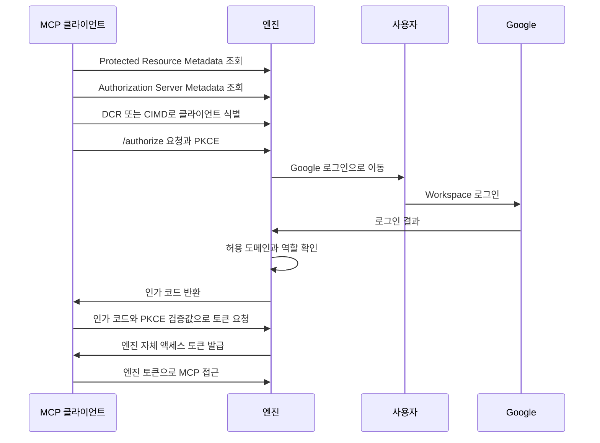

# 인증과 권한
엔진은 웹과 MCP 사용자를 Google Workspace 로그인으로 확인하고, MCP 접근에는 엔진 자체 OAuth 토큰을 발급한다.

## 배경

웹과 외부 MCP 클라이언트가 같은 지식 저장소에 접근하므로 사용자 확인과 엔진의 접근 권한을 연결해야 한다. Google은 사용자 신원을 확인하는 역할을 맡고, 엔진은 허용 도메인과 역할을 적용하는 역할을 맡는다.

## 내용

### 웹 로그인과 접근 제어

웹은 Google OAuth의 OpenID Connect 로그인을 사용한다. 허용 도메인은 ID 토큰의 `hd` 클레임과 이메일 도메인을 함께 검사한다. 로그인 성공만으로 접근을 허용하지 않고, Workspace 도메인과 이메일 도메인이 허용 설정에 맞는지도 확인한다.

기본값은 허용된 Google Workspace 도메인의 모든 사용자에게 읽기·쓰기를 허용하는 것이다. 허용 도메인과 관리자·읽기 전용 등의 역할은 별도로 설정할 수 있어야 한다. 예를 들어 같은 허용 도메인의 사용자라도 읽기 전용 역할로 설정하면 쓰기 권한과 구분할 수 있다.

### MCP의 OAuth 인가 서버

엔진은 MCP 인가 사양에 맞는 OAuth 2.1 인가 서버 역할을 한다. MCP 클라이언트가 `/authorize`로 접근하면 엔진은 사용자 로그인을 Google에 위임하고, 로그인 결과를 확인한 뒤 엔진 자체 액세스 토큰을 발급한다. Google 토큰을 MCP 클라이언트에 그대로 전달하지 않는다.

이 구분은 Google 사용자 확인과 지식 저장소 접근 인가를 분리하기 위한 것이다. 클라이언트가 접근하려는 대상은 Google API가 아니라 엔진이므로, 엔진이 발급한 토큰으로 엔진의 도메인·역할 정책을 적용한다.

엔진이 지원하는 MCP 인가 구성 요소는 다음과 같다. 대상 클라이언트가 사용하는 발견·클라이언트 식별·인가 방식을 수용하기 위해 이 구성을 선택한다.

- Protected Resource Metadata는 클라이언트가 보호된 MCP 리소스의 인가 서버를 발견하는 데 사용한다.
- Authorization Server Metadata는 클라이언트가 인가 서버의 구성과 지원 기능을 발견하는 데 사용한다.
- PKCE는 인가 코드 흐름을 클라이언트가 시작한 요청과 연결하는 데 사용한다.
- DCR은 클라이언트의 동적 등록을 지원한다.
- CIMD는 Client ID Metadata Documents를 통한 클라이언트 식별을 지원한다.

### MCP 로그인 흐름

다음 흐름에서 Google 로그인 결과를 받는 주체와 MCP 토큰을 발급하는 주체는 모두 엔진이다. Google 토큰을 클라이언트로 넘기는 단계는 없다.

## 열린 쟁점

허용 도메인과 역할을 환경변수·설정 파일에서 지정할지, 웹 관리 화면에서 지정할지는 정하지 않았다. 설정 가능하다는 요구와 설정 위치의 결정은 구분한다.

## 관련 문서

- [MCP](mcp.md)는 인증 후 제공하는 지식 도구와 리소스를 설명한다.
- [설치형 Skills](skills.md)는 대상 클라이언트별 연결과 로그인 설정 방법을 설명한다.
- [웹](web.md)은 브라우저에서 제공하는 기능을 설명한다.
