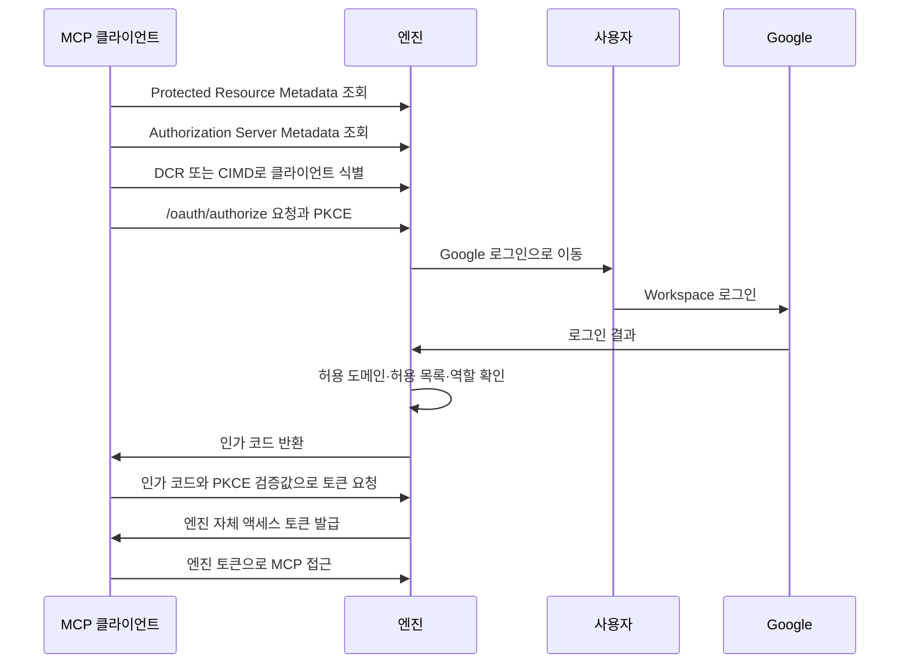

# 인증과 권한
엔진은 웹과 MCP 사용자를 Google Workspace 로그인으로 확인하고, MCP 접근에는 엔진 자체 OAuth 토큰을 발급한다.

## 배경

웹과 외부 MCP 클라이언트가 같은 지식 저장소에 접근하므로 사용자 확인과 엔진의 접근 권한을 연결해야 한다. Google은 사용자 신원을 확인하는 역할을 맡고, 엔진은 허용 도메인과 역할을 적용하는 역할을 맡는다.

## 내용

### Nest 모듈 구성

`AuthModule`은 사용자·세션·Google OIDC·OAuth 제공자와 인증 컨트롤러를 등록한다. `UsersRepository`와 `OAuthRepository`는 SQL 데이터 접근을 담당하며, `UsersService`는 사용자 검증·로그인 정책·마지막 관리자 보호를 담당한다. `SessionsService`는 서명된 쿠키와 DB 세션을 관리하고, `GoogleOidcService`는 브라우저에 결합된 OIDC 요청과 Google 신원 검증을 담당한다. Google issuer는 `GOOGLE_ISSUER` 제공자 토큰으로 주입하므로 테스트에서는 로컬 issuer로 교체한다.

인증 모듈은 웹과 MCP 모듈에 사용자·세션 서비스와 가드를 내보낸다. Nest는 컨트롤러에 지정한 가드를 해당 컨트롤러 모듈의 DI 범위에서도 생성하므로, `McpAuthGuard`가 의존하는 `OAuthService`도 내보내 MCP 모듈에서 주입을 해결한다. 모듈 간 순환 의존은 두지 않는다.

`AuthController`는 `/auth/*`, `OAuthController`는 `/oauth/*`와 `/.well-known/*`를 제공한다. OAuth 서비스는 클라이언트 검증과 코드·토큰 수명 주기를 담당한다. 리디렉션과 OAuth 오류 응답은 Express 응답 객체를 통해 기존 상태·헤더·본문을 유지하며, 토큰과 폐기 요청은 URL-encoded 폼을 받는다. 웹 API는 `SessionGuard`로 현재 사용자를 확인하고 `RolesGuard`와 `@Roles()`로 최소 역할을 검사한다. 역할 메타데이터가 없으면 `viewer`가 최소 역할이다. `@CurrentUser()`는 가드가 설정한 요청 사용자를 컨트롤러에 전달한다.

CLI의 `user add|role|list`는 `auth.commands.ts`에 정의하며, 지연 생성한 Nest 애플리케이션 컨텍스트에서 `UsersService`를 조회한다. 인증 모듈은 HTTP 실행과 CLI 실행 모두에서 같은 제공자를 사용하며, 별도 Express 라우터나 서비스들을 묶어 전달하는 기존 `AppContext` 객체를 두지 않는다.

### 웹 로그인과 접근 제어

웹은 Google OAuth의 OpenID Connect 로그인을 사용한다. 허용 도메인은 ID 토큰의 `hd` 클레임과 이메일 도메인을 함께 검사한다. 로그인 성공만으로 접근을 허용하지 않고, Workspace 도메인과 이메일 도메인이 허용 설정에 맞는지도 확인한다.

기본값은 허용 목록 사용(`allowlistEnabled=true`)과 빈 허용 도메인 목록(`allowedDomains=[]`)이다. 첫 관리자를 CLI로 등록한 뒤 웹 관리 화면에서 다음 설정을 변경한다. 빈 도메인 목록은 도메인 제한을 적용하지 않지만 Google의 검증된 이메일은 여전히 필요하다.

- 허용 목록을 켜면 `users` 테이블에 등록된 이메일만 로그인할 수 있다. 끄면 도메인 검사를 통과한 신규 사용자를 `viewer`로 자동 등록한다.
- 허용 도메인 목록이 비어 있지 않으면 이메일 도메인과 Google ID 토큰의 `hd`가 서로 같고 목록에 포함되어야 한다. 대소문자를 구분하지 않으며, `hd`가 없으면 거절한다.
- 사용자별 역할은 `admin`, `editor`, `viewer`다. `viewer`는 읽기·검색·채팅을 수행하고, `editor`는 지식 쓰기를 추가로 수행하며, `admin`은 관리 설정까지 수행한다. 마지막 관리자는 삭제하거나 다른 역할로 내릴 수 없으며, 해당 요청은 409 응답을 받는다.

웹 관리 화면의 접점은 [웹 버전](web.md#로그인과-관리-화면)에 설명한다.

### 첫 관리자 등록과 비상 복구

CLI는 첫 관리자 등록과 관리자 계정을 잃었을 때의 비상 복구에만 사용한다. 처음에는 웹에 로그인해 관리 설정을 바꿀 관리자가 없으므로, 웹 밖에서 첫 관리자를 만들어야 한다. 이후의 사용자·권한 관리는 웹 관리 화면에서 수행한다.

첫 관리자 등록과 비상 복구 명령은 다음과 같다.

```bash
llmwiki user add a@example.com --role admin --name "관리자"
llmwiki user role a@example.com admin
llmwiki user list
```

로그인은 Google 인가 코드, PKCE S256, 임의의 `state`와 `nonce`를 사용한다. 10분 유효한 로그인 요청은 브라우저 쿠키와 결합하며 한 번만 사용한다. 콜백은 JWKS 서명과 `iss`, `aud`, `exp`, `nonce`, `email_verified`를 검증한 뒤 접근 정책을 적용한다. Google 클라이언트 설정이 없으면 서버는 시작할 수 있으나 로그인은 설정 오류를 반환한다.

웹 세션은 DB에 저장한 임의 식별자의 SHA-256 해시와 `SESSION_SECRET`으로 서명한 쿠키를 사용한다. `llmwiki_session` 쿠키는 `HttpOnly`, `SameSite=Lax`, 30일 유효 기간을 가지며 `PUBLIC_URL`이 HTTPS면 `Secure`를 추가한다. 로그아웃은 쿠키와 DB 세션을 함께 삭제한다. 개발 환경에서는 기존 사용자 이메일을 `DEV_LOGIN_EMAIL`에 지정해 `/auth/dev-login`으로 로그인할 수 있다. 운영 환경에서는 이 설정을 거부한다.

### MCP의 OAuth 인가 서버

엔진은 MCP 인가 사양에 맞는 OAuth 인가 서버 역할을 한다. MCP 클라이언트가 `/oauth/authorize`로 접근하면 엔진은 사용자 로그인을 Google에 위임하고, 로그인 결과를 확인한 뒤 엔진 자체 액세스 토큰을 발급한다. Google 토큰을 MCP 클라이언트에 그대로 전달하지 않는다.

이 구분은 Google 사용자 확인과 지식 저장소 접근 인가를 분리하기 위한 것이다. 클라이언트가 접근하려는 대상은 Google API가 아니라 엔진이므로, 엔진이 발급한 토큰으로 엔진의 도메인·역할 정책을 적용한다.

엔진이 지원하는 MCP 인가 구성 요소는 다음과 같다. 대상 클라이언트가 사용하는 발견·클라이언트 식별·인가 방식을 수용하기 위해 이 구성을 선택한다.

- Protected Resource Metadata는 `/.well-known/oauth-protected-resource`와 `/.well-known/oauth-protected-resource/mcp`에서 제공한다. 리소스 식별자는 `PUBLIC_URL`의 `/mcp`다.
- Authorization Server Metadata는 `/.well-known/oauth-authorization-server`에서 제공한다.
- `/oauth/authorize`는 등록된 `redirect_uri`, `response_type=code`, `code_challenge_method=S256`, PKCE challenge, `resource`를 검사한다. 성공한 로그인은 5분 유효한 일회용 엔진 인가 코드를 클라이언트에 반환한다. 검증된 리디렉션 주소에는 인가 오류도 `error`와 원래 `state`로 반환한다. 알 수 없는 클라이언트나 미등록 리디렉션 주소에는 이동하지 않고 400 오류를 반환한다.
- `/oauth/register`는 DCR을 제공한다. 공개 클라이언트(`token_endpoint_auth_method=none`)만 지원하며 리디렉션은 HTTPS 또는 로컬 루프백 HTTP여야 한다.
- CIMD는 HTTPS URL 형태의 `client_id` 문서를 가져와 URL과 문서의 `client_id` 및 리디렉션 목록을 확인한다. 문서는 1시간 캐시하고, 64 KiB 크기와 5초 요청 제한을 적용하며 리디렉션 응답과 사설 네트워크 주소를 거부한다. 테스트 환경에서만 HTTP 문서를 허용한다.
- `/oauth/token`은 PKCE를 검증해 1시간 액세스 토큰과 30일 리프레시 토큰을 발급한다. 리프레시 때 새 토큰을 발급하고 이전 리프레시 토큰을 폐기한다. `/oauth/revoke`로 액세스 토큰을 폐기할 수 있으며, 리프레시 토큰을 폐기하면 같은 발급 계열의 액세스·리프레시 토큰도 폐기한다. DB에는 코드·토큰의 SHA-256 해시만 저장한다.
- MCP 미인증 요청은 401과 `WWW-Authenticate: Bearer …, resource_metadata="…/.well-known/oauth-protected-resource/mcp"`를 반환한다. 토큰 검증 후 현재 사용자 역할을 다시 조회하므로 역할 변경은 다음 요청부터 적용된다.

`McpAuthGuard` 안에서 MCP SDK의 `requireBearerAuth`를 사용해 Bearer 파싱, 만료·리소스 검사와 표준 오류 헤더를 재사용한다. Nest가 Express 어댑터를 사용하므로 요청·응답 객체를 그대로 전달할 수 있으며, SDK가 이미 오류 응답을 보낸 경우 가드는 컨트롤러 실행을 막고 전역 오류 필터는 전송된 응답을 덮어쓰지 않는다. 따라서 인증 파싱을 다시 구현하지 않고 기존 OAuth 오류 형식과 `WWW-Authenticate`를 유지한다. `mcpAuthRouter`와 `OAuthServerProvider`는 사용하지 않는다. 브라우저에 결합된 Google 로그인 요청과 공용 콜백, DB 트랜잭션 기반 코드·토큰 수명 주기를 같은 모듈에서 처리하는 쪽이 어댑터 중복을 줄이기 때문이다.

### MCP 로그인 흐름

다음 흐름에서 Google 로그인 결과를 받는 주체와 MCP 토큰을 발급하는 주체는 모두 엔진이다. Google 토큰을 클라이언트로 넘기는 단계는 없다.



## 관련 문서

- [MCP](mcp.md)는 인증 후 제공하는 지식 도구와 리소스를 설명한다.
- [설치형 Skills](skills.md)는 대상 클라이언트별 연결과 로그인 설정 방법을 설명한다.
- [웹](web.md)은 브라우저에서 제공하는 기능을 설명한다.
