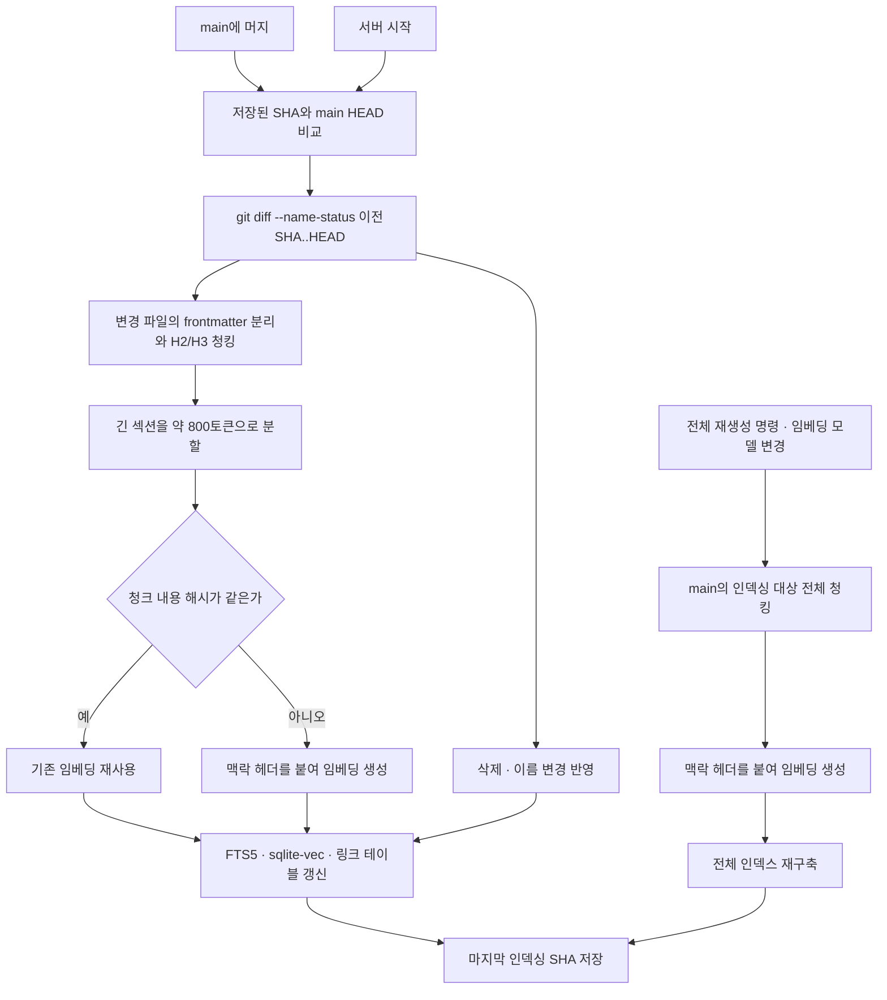
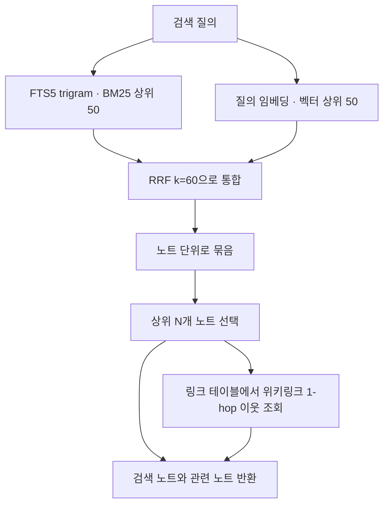

# RAG 설계
엔진은 지식 저장소의 main에서 검색 인덱스를 파생하고, 키워드·벡터·위키링크를 함께 사용해 관련 지식을 찾는다.

## 배경

관련 지식을 찾는 일은 질문에 답할 때뿐 아니라 새 지식을 기존 노트에 반영하고 충돌·중복을 정리할 때도 필요하다.
검색 인덱스는 main의 마크다운을 진실 원천으로 삼는 파생물이며, 언제든 다시 만들 수 있다.
따라서 작업 워크트리의 미머지 변경은 인덱싱하지 않고, 모든 검색은 main 기준으로 수행한다.
지식 저장소 자체의 구성과 보존 정책은 [지식 저장소](knowledge-repository.md)에서 다룬다.

## 내용

### 저장 구조와 한국어 검색

검색 데이터는 SQLite 하나에 저장하며, FTS5는 키워드 검색을, sqlite-vec은 벡터 검색을, 링크 테이블은 노트 사이의 위키링크 관계를 담당한다.
DB 선택 이유, sqlite-vec의 위험과 검색 모듈 경계, PostgreSQL로 전환할 조건은 [DB 선택](architecture.md#db-선택)에 기록한다.

FTS5 기본 토크나이저인 unicode61은 공백으로 구분된 한국어 단어에서 조사를 떼어내지 않는다.
예를 들어 본문의 `저장소는`은 `저장소`와 다른 토큰이므로, `저장소`라는 질의로 해당 표현을 찾지 못한다.
이를 피하기 위해 부분 문자열을 매칭하는 trigram 토크나이저를 사용한다.
다만 3글자 미만 질의는 trigram으로 찾을 수 없으므로 벡터 검색에 의존한다.

### 인덱싱 범위와 청크 문맥

인덱싱 대상은 `wiki/`, `journal/`, `raw/`이며, 각 청크에는 노트·일기·원문을 구분하는 종류(`kind`) 필드를 둔다.
메모리 파일인 `MEMORY.md`는 검색 대상에서 제외하고 항상 문맥에 주입한다.

청킹은 frontmatter를 분리한 뒤 H2/H3 섹션 단위로 수행하며, 긴 섹션은 약 800토큰 단위로 나눈다.
임베딩 입력 앞에는 `노트 제목 > 섹션 경로`와 태그를 맥락 헤더로 붙인다.
이는 청크가 노트의 일부만 담더라도 어느 주제와 섹션에 속하는지 함께 전달하기 위한 장치다.
예를 들어 노트 제목이 `지식 저장소`, H2가 `검색`, H3가 `한국어`, 태그가 `검색`이라면 헤더는 다음처럼 표현한다.

```text
지식 저장소 > 검색 > 한국어
태그: 검색
```

임베딩 모델은 OpenAI `text-embedding-3-small`을 사용하고 설정으로 변경할 수 있다.
인덱스 메타데이터에 모델명을 저장하며, 모델을 바꾸면 전체 재인덱싱한다.
Luna와 별도 임베딩 모델을 사용하는 이유는 [Luna](luna.md)에서 다룬다.

### 증분 인덱싱과 복구

마지막으로 인덱싱한 커밋 SHA를 저장하고, main에 머지될 때마다 `git diff --name-status 이전SHA..HEAD`로 변경 파일을 찾는다.
변경된 파일만 다시 청킹하고, 청크 내용 해시가 같으면 기존 임베딩을 재사용한다.
파일 삭제와 이름 변경도 인덱스에 반영한다.

서버 시작 시에는 저장된 SHA와 main의 HEAD를 맞춰 누락된 변경을 반영한다.
전체 인덱스를 다시 생성하는 명령도 제공하므로 파생 인덱스를 원문에서 재구축할 수 있다.



작업 워크트리에서 쓰는 동안에는 이 경로를 실행하지 않으며, main에 머지된 뒤에만 검색 결과에 반영한다.
머지까지의 작업 절차는 [쓰기 흐름](write-flow.md)에서 다룬다.

### 하이브리드 검색

키워드 검색의 BM25 상위 50개와 벡터 검색 상위 50개를 가져와 RRF로 합치며, RRF의 상수는 `k=60`으로 둔다.
합친 청크 결과를 노트 단위로 묶은 뒤 상위 N개 노트를 선택한다.
선택된 노트의 위키링크 1-hop 이웃은 별도의 관련 노트로 함께 반환한다.
키워드와 의미 유사도로 직접 찾은 노트에 링크로 이어지는 맥락을 보태는 구조다.



### 사용처

- [MCP](mcp.md)의 `search`는 하이브리드 검색을 제공한다.
- [웹 버전](web.md)의 질의응답은 Luna가 `search`와 `read_note`를 반복 호출하는 에이전트형 RAG이며, 답변에 근거 노트를 인용한다.
- [쓰기 흐름](write-flow.md)은 새 노트를 만들기 전에 기존 노트를 검색해 기존 지식에 반영할 수 있는지 판단한다.
- [dreaming](dreaming.md)은 변경 노트와 가까운 노트를 찾아 충돌·중복 후보로 사용한다.

## 검토한 대안

- OpenAI 호스티드 `file_search` 벡터 스토어는 지식을 외부 벡터 스토어에 복제하고 git과 동기화해야 하며, MCP 검색까지 그 스토어에 의존하게 되므로 채택하지 않았다.
- PostgreSQL 대안 검토는 [DB 선택](architecture.md#db-선택)에 기록한다. Qdrant는 컨테이너 하나 요구사항과 맞지 않으므로 채택하지 않았다.

## 관련 문서

- [엔진 구성](architecture.md)은 RAG가 포함되는 운영 구조와 단일 컨테이너 선택의 이유를 설명한다.
- [지식 저장소](knowledge-repository.md)는 검색 원문이 놓이는 저장소의 구조를 설명한다.
- [Luna](luna.md)는 검색 결과를 사용하는 LLM과 임베딩 모델의 역할 구분을 설명한다.
- [MCP](mcp.md)와 [웹 버전](web.md)은 검색을 사용하는 사용자 인터페이스를 설명한다.
- [쓰기 흐름](write-flow.md)과 [dreaming](dreaming.md)은 검색이 지식 정리에 사용되는 절차를 설명한다.
