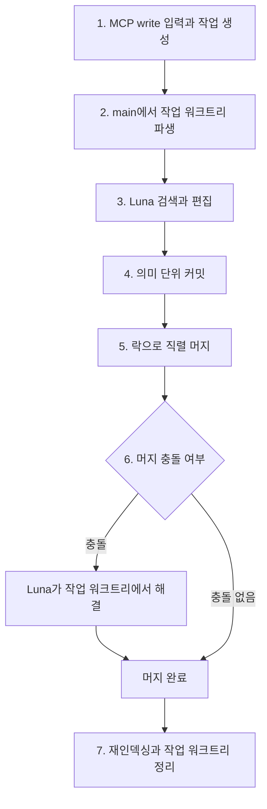

# 지식 쓰기 흐름

엔진은 쓰기 요청을 작업 워크트리에서 처리하고 직렬 머지를 거쳐 지식 저장소에 반영한다.

## 배경

여러 쓰기 요청이 동시에 같은 파일을 수정할 수 있으므로 요청마다 작업 워크트리를 사용해 편집을 격리한다. 예를 들어 두 요청이 같은 노트를 확장하더라도 각 요청의 편집은 서로의 작업 파일을 덮어쓰지 않는다. 최종 반영 대상인 main의 역할은 [지식 저장소](knowledge-repository.md)에 설명한다.

작업 워크트리는 편집을 격리하지만 머지 충돌까지 없애지는 않는다. main에 대한 머지를 한 번에 하나씩 처리하면 동시 쓰기 작업의 최종 반영이 서로 경합하지 않으며, 충돌은 Luna가 해결한다.

## 내용

### 비동기 작업과 상태 조회

MCP `write`는 비동기로 처리하며, 호출 즉시 작업 ID를 반환한다. 클라이언트는 `get_write_status`로 해당 작업의 상태를 조회한다. 작업 상태는 SQLite에서 관리하므로, 제출 응답이 아니라 상태 조회를 통해 반영 결과를 확인한다.

쓰기 입력에는 [웹 대화 기록](web.md#대화-기록과-학습)도 포함한다.

### 일곱 단계

1. MCP `write` 도구가 자연어 지시나 원문을 받아 쓰기 작업을 생성한다.
2. main에서 해당 작업의 작업 워크트리를 파생한다.
3. Luna가 검색으로 관련 노트를 먼저 찾고 기존 노트 확장과 새 노트 생성 중 적합한 방식을 선택해 편집한다. 필요하면 `index.md`와 메모리 파일도 갱신하며, 편집에는 [작성 규칙](writing-rules.md)을 적용한다.
4. 의미 단위마다 커밋하며, 한 작업에서도 여러 번 커밋할 수 있다.
5. 락으로 main 머지를 한 번에 하나씩 직렬 처리한다.
6. 머지 충돌이 발생하면 Luna가 작업 워크트리에서 해결한 뒤 머지를 완료한다.
7. 머지 후 변경 파일을 재인덱싱하고 작업 워크트리를 정리한다. 재인덱싱 방식과 main 기준 검색의 경계는 [RAG](rag.md)에 설명한다.

### 요청자와 커밋 수행자의 구분

커밋의 author는 요청한 사용자로, committer는 Luna 봇 계정으로 기록한다. 이렇게 하면 누가 요청한 지식인지 추적하면서 실제 커밋 수행자도 구분할 수 있다. 예를 들어 사용자가 기존 노트에 새 근거를 반영하도록 요청하면, Luna가 편집하고 커밋하더라도 author에는 그 사용자를 기록한다.

## 관련 문서

- [MCP](mcp.md)는 쓰기 요청을 포함한 클라이언트 제공 범위를 설명한다.
- [Luna](luna.md)는 편집과 충돌 해결에 사용하는 모델과 도구를 설명한다.
- [작성 규칙](writing-rules.md)은 노트 검색과 편집의 기준을 설명한다.
- [지식 저장소](knowledge-repository.md)는 main과 파일 배치의 역할을 설명한다.
- [RAG](rag.md)는 머지 후 검색 인덱스 갱신 방식을 설명한다.
