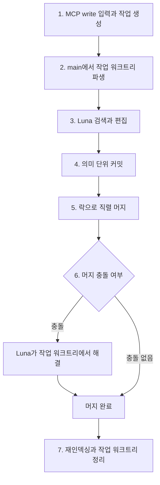

# 지식 쓰기 흐름

엔진은 쓰기 요청을 작업 워크트리에서 처리하고 직렬 머지를 거쳐 지식 저장소에 반영한다.

## 배경

여러 쓰기 요청이 동시에 같은 파일을 수정할 수 있으므로 요청마다 작업 워크트리를 사용해 편집을 격리한다. 예를 들어 두 요청이 같은 노트를 확장하더라도 각 요청의 편집은 서로의 작업 파일을 덮어쓰지 않는다. 최종 반영 대상인 main의 역할은 [지식 저장소](knowledge-repository.md)에 설명한다.

작업 워크트리는 편집을 격리하지만 머지 충돌까지 없애지는 않는다. main에 대한 머지를 한 번에 하나씩 처리하면 동시 쓰기 작업의 최종 반영이 서로 경합하지 않으며, 충돌은 Luna가 해결한다.

## 내용

### 비동기 작업과 상태 조회

MCP `write`는 비동기로 처리하며, 호출 즉시 작업 ID를 반환한다. 클라이언트는 `get_write_status`로 해당 작업의 상태를 조회한다. 작업 상태는 SQLite에서 관리하므로, 제출 응답이 아니라 상태 조회를 통해 반영 결과를 확인한다.

`write_jobs`에는 `queued → running → merging → succeeded` 전이를 저장한다. 실패 시에는 `failed`로 끝나며 오류 메시지를 남긴다. 생성·시작·종료 시각은 UTC ISO-8601 문자열이다. 작업의 요약, 작업 브랜치에서 만든 커밋 SHA 배열, 최종 main SHA도 기록한다. main에서 이미 존재하던 다른 작업의 커밋은 이 배열에 넣지 않으며, 이번 작업의 머지 커밋은 포함한다.

`JobsModule`은 `WriteJobsRepository`와 `WriteJobsService`를 제공자로 등록하고 서비스를 다른 모듈에 내보낸다. `write-job.types.ts`의 `WriteJob`이 작업 데이터 형식을 정의하며, `write-jobs.repository.ts`가 SQLite 작업 조회와 상태 갱신 SQL을 맡는다. `write-jobs.service.ts`의 서비스는 저장소, `LunaService`, `IndexerService`, `KnowledgeRepo`, `UsersService`와 로그를 생성자 DI로 받아 워커와 머지 흐름을 수행한다. 요청자 조회는 `UsersService`를 통해 사용자 모듈의 저장소에 위임한다.

현재 쓰기 큐는 Luna 실행 하나만 사용하는 단일 워커다. 대기 작업은 생성 시각 순으로 처리하고 같은 시각이면 삽입 순서를 따른다. dreaming처럼 큐 밖에서 실행하는 작업과의 main 경합도 저장소의 프로세스 내 머지 락으로 직렬화한다. 이 구성은 하나의 엔진 프로세스를 전제로 하며 여러 엔진을 같은 데이터 디렉터리에 실행하지 않는다.

엔진을 시작할 때 이전 실행의 `running`·`merging` 작업은 중단 사유와 종료 시각을 기록해 `failed`로 바꾼다. `queued` 작업만 다시 처리한다. 종료 요청은 현재 실행 중인 작업을 끝까지 기다리고 다음 대기 작업을 시작하지 않는다.

워커 시작은 HTTP 진입점 `main.ts`에서 `WriteJobsService.start()`를 명시적으로 호출한다. 모듈 초기화나 CLI 애플리케이션 컨텍스트 생성만으로는 큐를 소비하지 않는다. 애플리케이션 종료 훅은 `stop()`을 기다려 실행 중인 작업과 워크트리 정리가 끝난 뒤 공용 DB 연결을 닫을 수 있게 한다.

### 일곱 단계

1. MCP `write` 도구가 자연어 지시나 원문을 받아 쓰기 작업을 생성한다.
2. main에서 해당 작업의 작업 워크트리를 파생한다.
3. Luna가 검색으로 관련 노트를 먼저 찾고 기존 노트 확장과 새 노트 생성 중 적합한 방식을 선택해 편집한다. 필요하면 `index.md`와 메모리 파일도 갱신하며, 편집에는 [작성 규칙](writing-rules.md)을 적용한다.
4. 의미 단위마다 커밋하며, 한 작업에서도 여러 번 커밋할 수 있다.
5. 락으로 main 머지를 한 번에 하나씩 직렬 처리한다.
6. 머지 충돌이 발생하면 Luna가 작업 워크트리에서 해결한 뒤 머지를 완료한다. 엔진은 충돌 파일과 워크트리의 파일에서 충돌 마커가 남았는지 검사하며, 마커가 남으면 main에 반영하지 않고 작업을 실패 처리한다.
7. 머지 후 변경 파일을 재인덱싱하고 작업 워크트리를 정리한다. 재인덱싱 실패는 로그에 기록하지만 이미 main에 반영된 작업은 성공으로 유지한다. 재인덱싱 방식과 main 기준 검색의 경계는 [RAG](rag.md)에 설명한다.

### 요청자와 커밋 수행자의 구분

커밋의 author는 요청한 사용자로, committer는 Luna 봇 계정으로 기록한다. 이렇게 하면 누가 요청한 지식인지 추적하면서 실제 커밋 수행자도 구분할 수 있다. 예를 들어 사용자가 기존 노트에 새 근거를 반영하도록 요청하면, Luna가 편집하고 커밋하더라도 author에는 그 사용자를 기록한다.

사용자 이름과 이메일은 실행 시 `users` 테이블에서 읽는다. 이름이 없으면 이메일을 author 이름으로 사용한다. 요청자가 실행 전에 삭제되었다면 작업을 실패 처리한다. 완료된 작업은 사용자 삭제 후에도 감사 이력을 위해 남긴다.

Luna가 커밋하지 않고 남긴 수정은 엔진이 실행 요약의 첫 줄을 최대 200자로 잘라 커밋한다. 요약이 비어 있으면 `Update knowledge`를 사용한다. 내용이 바뀌지 않은 작업은 새 커밋 없이 성공할 수 있다. 일반 커밋과 충돌을 해결한 머지 커밋 모두 요청자를 author로, 설정의 `GIT_BOT_NAME`·`GIT_BOT_EMAIL`을 committer로 사용한다.

쓰기 또는 충돌 해결 실패 시에는 워크트리와 작업 브랜치를 정리하며 해당 작업의 변경을 main에 반영하지 않는다. 이미 main을 반영한 뒤 워크트리 정리가 실패하면 작업 성공은 유지하고 정리 실패를 로그에 남긴다. 다음 시작 시 저장소 복구가 남은 워크트리와 작업 브랜치를 제거한다.

### 잘못된 지식의 정정

별도의 되돌리기(revert) 기능이나 승인 단계를 두지 않는다. 잘못된 지식은 자연어 지시나 원문으로 정정 `write`를 제출해 다시 쓰는 방식으로 고친다. 예를 들어 이전에 저장한 사실이 틀렸다면 올바른 사실과 정정 지시를 제출하고, 같은 쓰기 흐름으로 기존 노트에 반영한다.

누가 요청했고 무엇이 바뀌었는지를 확인하는 화면과 이력의 원천은 [웹 변경 이력](web.md#변경-이력)에 설명한다.

## 관련 문서

- [MCP](mcp.md)는 쓰기 요청을 포함한 클라이언트 제공 범위를 설명한다.
- [Luna](luna.md)는 편집과 충돌 해결에 사용하는 모델과 도구를 설명한다.
- [작성 규칙](writing-rules.md)은 노트 검색과 편집의 기준을 설명한다.
- [지식 저장소](knowledge-repository.md)는 main과 파일 배치의 역할을 설명한다.
- [RAG](rag.md)는 머지 후 검색 인덱스 갱신 방식을 설명한다.
- [웹 버전](web.md#변경-이력)은 노트별·쓰기 작업별 변경 이력을 설명한다.
